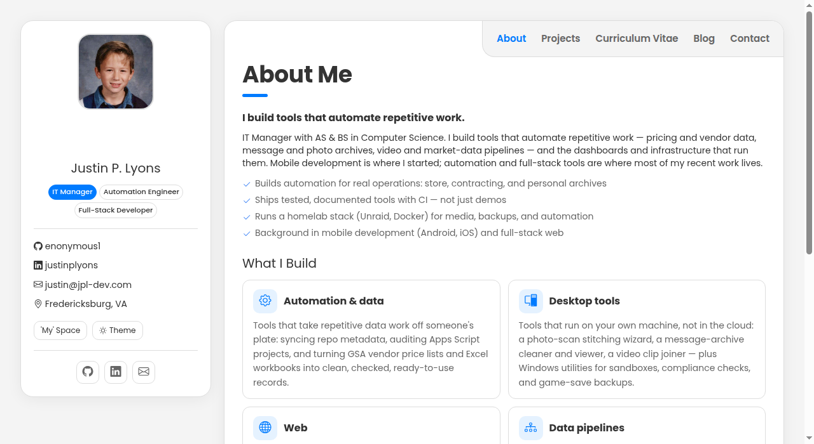
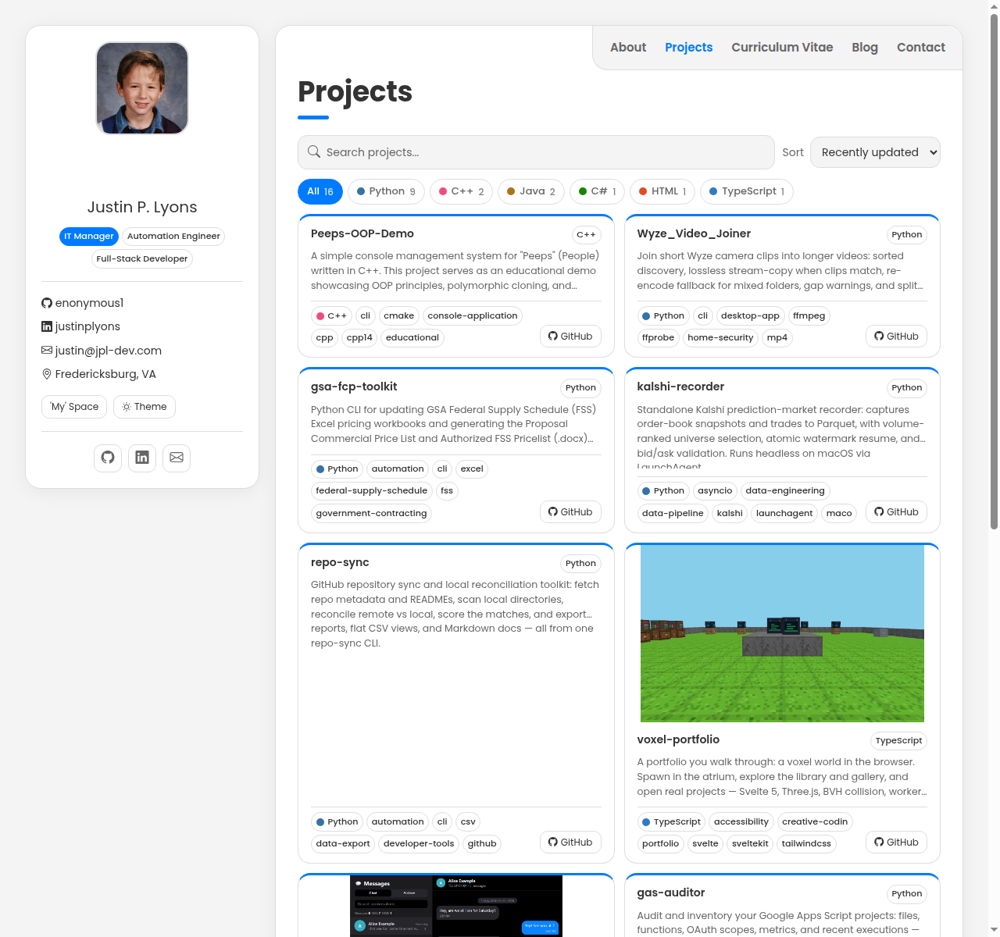
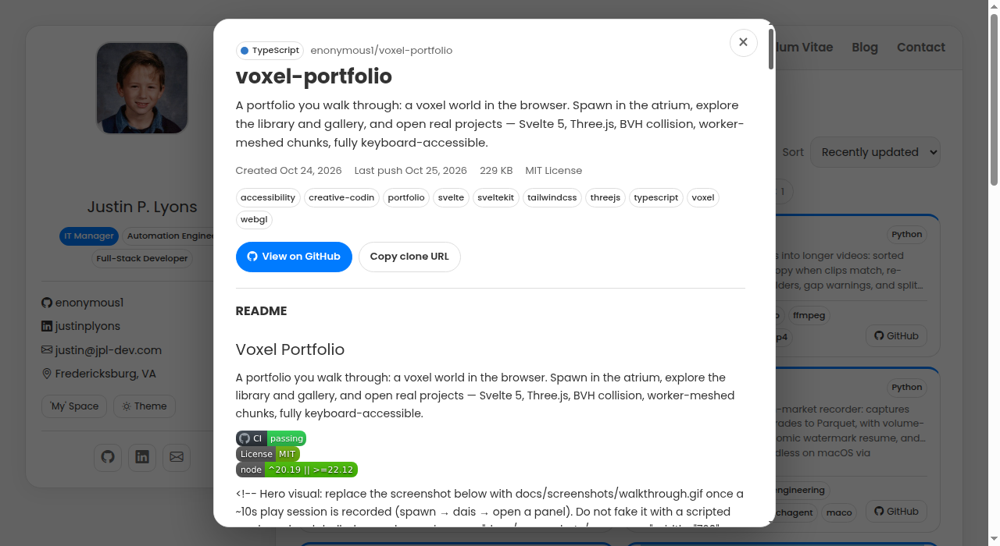
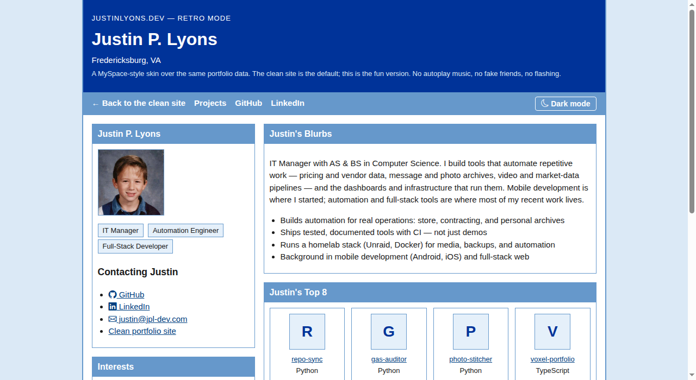
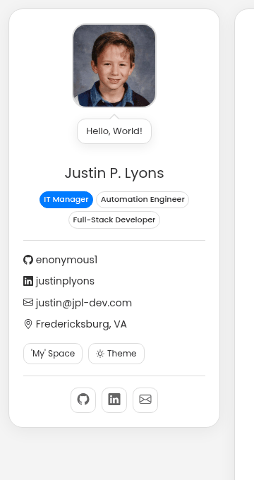
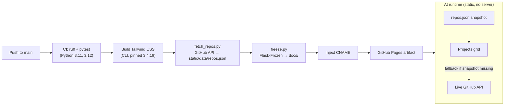

# jpl-dev — Justin P. Lyons Digital Portfolio

Personal portfolio site, live at [justinlyons.dev](https://justinlyons.dev).



## Description

A portfolio site built with Flask for development ergonomics and frozen
to static files for $0 GitHub Pages hosting. There is no live server, no
database, and no auth surface to maintain — the frozen site is plain
HTML, CSS, and JavaScript, and everything dynamic (project listings,
section switching, theme) happens in the browser.

Project listings come from GitHub, not a catalog in the repo: a CI step
snapshots public repo metadata into `static/data/repos.json`, and the
homepage loads that snapshot with a live GitHub API fallback. The site
has two skins over the same data — the clean vCard homepage (default)
and an optional MySpace-style retro mode at `/retro/`.

## Prerequisites

- Python 3.11 or higher (the code uses PEP 585 built-in generics, e.g. `list[str]`)
- pip
- Node.js 24 — only needed when Tailwind template classes change, so the
  CSS bundle can be rebuilt (CI rebuilds it on every deploy regardless)
- Git, for cloning and pushing

## Installation

```bash
git clone https://github.com/enonymous1/jpl-dev.git
cd jpl-dev

# Isolated environment (recommended)
python -m venv .venv
source .venv/bin/activate   # Windows PowerShell: .venv\Scripts\Activate.ps1

# Runtime dependencies
pip install -r requirements.txt

# Dev dependencies (tests + lint)
pip install -r requirements-dev.txt
```

All Python dependencies are pinned with `==` in the requirements files,
so an install today reproduces the CI environment.

## Local Development

### Run the dev server

```bash
python app.py
```

This serves the Flask app locally (the frozen build is what deploys, so
the dev server is for iteration only). For debug mode:

```bash
FLASK_ENV=development python app.py
```

### Refresh GitHub repo data

```bash
# Fetches public repos (paginated, forks/archived filtered out) into
# static/data/repos.json. On an API failure it keeps the cached file
# and warns instead of failing the build. Set GITHUB_TOKEN to raise
# the API rate limit from 60 to 5,000 requests/hour.
python fetch_repos.py
```

Local dev works without this step: the homepage falls back to the live
GitHub API when the snapshot is absent or empty.

### Write a blog post

Posts are Markdown files in `content/posts/`, each starting with a
front-matter block (`title`, `slug`, `date` as `YYYY-MM-DD`, `summary`
required; `tags` and `pinned` optional). Pinned posts sort first
regardless of date. Scaffold one with:

```bash
python new_post.py "My Post Title"
```

Unfinished posts belong in `content/drafts/`, which the loader never
reads, so they cannot publish by accident. Bad front matter (unknown
keys, duplicate slugs, bad dates, empty bodies) fails the build instead
of publishing half-rendered. Each post freezes to `/blog/<slug>/`,
appears in `sitemap.xml`, and is included in the RSS feed at `/feed.xml`.
The Blog tab only renders when at least one post exists.

### Build Tailwind CSS

CI rebuilds the Tailwind bundle before freezing, so the committed CSS is
only a local-dev convenience. Rebuild it after changing template classes:

```bash
npx --yes tailwindcss@3.4.19 \
  -c tailwind.config.js \
  -i static/css/tailwind.input.css \
  -o static/css/tailwind.css \
  --minify
```

### Generate the static site

```bash
# Generates docs/ (gitignored build output; CI builds it for Pages)
python freeze.py
```

`freeze.py` also writes `404.html` (served by GitHub Pages for unknown
paths), `robots.txt`, and `sitemap.xml` from the frozen routes. Preview
the output with any static server rooted at `docs/`:

```bash
python -m http.server 8000 --directory docs
```

### Checks

```bash
ruff check .
ruff format --check .
pytest
node --test tests/js/test_modules.test.js
```

These are the exact commands CI runs; a push that fails any of them
does not deploy.

## Features

- **vCard homepage** — A sidebar + tabbed main card (About / Projects /
  Curriculum Vitae / Blog / Contact), written for this site rather than
  copied from a template. Sections switch without a reload and
  deep-link via `#about`, `#projects`, `#cv`, `#blog`, `#contact`.
  The sidebar carries contact info, the 'My' Space retro link, and the
  theme toggle; there is no global top nav.
- **GitHub-driven Projects** — The Projects tab shows the full repo
  inventory with a search box, sort control (recently updated, name,
  stars), and GitHub-style language filter chips (color dot + count)
  derived from the loaded repos, never hardcoded. The first 10 projects
  show, with a Show-all expand control. Clicking a card opens a preview
  modal with the README rendered in the browser (fetched on open,
  cached for the session), repo metadata, and labeled GitHub / Pages
  site buttons. Twelve repos carry thumbnail images — real screenshots
  from their READMEs or Pages landing pages, never placeholders.





- **Curriculum Vitae tab** — Headline, summary, experience, education,
  certifications, top skills, and languages, with a Print / Save as PDF
  button. The definition subtitle is clickable: it cycles through a
  short set of Latin quips, then returns to the definition.
- **Retro Mode** — `/retro/` is a MySpace-style skin over the same
  About and repo data: a curated Top 8 showcase (filled from recent
  repos if a showcase repo is missing), its own light/dark toggle saved
  separately from the clean site's theme, no autoplay music, no fake
  friends, no flashing. It freezes like any other route.



- **Dark/light themes** — Client-side switching with system-preference
  detection, applied before first paint so the theme never flashes.
  The clean site and retro mode remember their themes independently.
- **Glossary and role definitions** — Every Tools & Tech pill and every
  role pill under the name opens a modal with a short definition; terms
  with an official source link out to it.
- **Contact** — A Fredericksburg map plus a form that composes a mailto
  message in the visitor's own email app (a static site has no server
  to receive a form post, and the form does not pretend otherwise).
  Nothing is stored.

### Details worth noticing

- **Avatar easter egg** — Hovering (or focusing) the profile photo
  shows a "Hello, World!" speech bubble; clicking cycles quips, and the
  fifth click spins the photo. It resets after 5 idle seconds.



## Architecture

Flask + Frozen-Flask: dynamic development ergonomics, static deployment.
The build crawls the Flask app at build time and produces flat files;
the browser then does everything else (tabs, theme, project grid,
modal, search) with no live Python runtime.



## Deployment

The site deploys to GitHub Pages when changes are pushed to `main` via
GitHub Actions. The workflow:

1. Runs lint (`ruff check`, `ruff format --check`) and tests (`pytest`)
   on Python 3.11 and 3.12 — deploys only if they pass
2. Builds the Tailwind CSS bundle
3. Refreshes GitHub repo metadata with `fetch_repos.py`
4. Runs Flask-Frozen to compile routes into flat static files in
   `docs/`, plus `404.html`, `robots.txt`, and `sitemap.xml`
5. Injects the `CNAME` for `justinlyons.dev` and deploys the artifact
   to GitHub Pages

Pull requests run the same lint/test/build steps without deploying, and
the workflow can also be re-run manually (`workflow_dispatch`).

GitHub Pages must be configured to deploy from **GitHub Actions** (not
from a branch folder), because `docs/` is build output and is not
tracked in git.

## Project Structure

```
├── app.py                 # Flask app (create_app factory) + routes + RSS feed
├── freeze.py              # Static site compiler + 404/robots/sitemap generation
├── fetch_repos.py         # GitHub repo metadata cache (static/data/repos.json)
├── new_post.py            # Blog post scaffolder
├── config/                # Profile, glossary, role, and resume data
├── content/posts/         # Published blog posts (Markdown + front matter)
│                          # (unfinished posts go in content/drafts/,
│                          # created when needed; the loader never reads it)
├── templates/             # Jinja2 templates (vCard homepage, retro skin, 404)
├── assets/                # README screenshots + avatar GIF (not shipped to Pages)
├── static/
│   ├── css/               # Tailwind bundle + hand-written styles
│   ├── js/                # Projects grid, preview modal, tabs, contact,
│   │                      # retro grid/theme (classic scripts, no bundler)
│   ├── *.js               # Theme, modals, avatar and Latin easter eggs
│   ├── data/repos.json    # Repo snapshot (refreshed in CI)
│   └── images/            # Profile photo + project thumbnails
├── tests/                 # pytest smoke + unit tests
├── tests/js/              # node --test cases for the JS modules' pure helpers
├── tailwind.config.js     # Tailwind content + theme configuration
├── pyproject.toml         # ruff + pytest configuration (no installable package)
├── requirements.txt       # Runtime dependencies (pinned)
├── requirements-dev.txt   # Dev dependencies (pytest, ruff)
├── .python-version        # 3.12 (CI also tests 3.11)
├── CNAME                  # Custom domain, injected into docs/ at deploy time
└── .github/workflows/     # CI + Pages deploy pipeline
```

`docs/` is generated by `freeze.py` and intentionally not tracked — do
not commit it.

## License

MIT — see [LICENSE](LICENSE).
